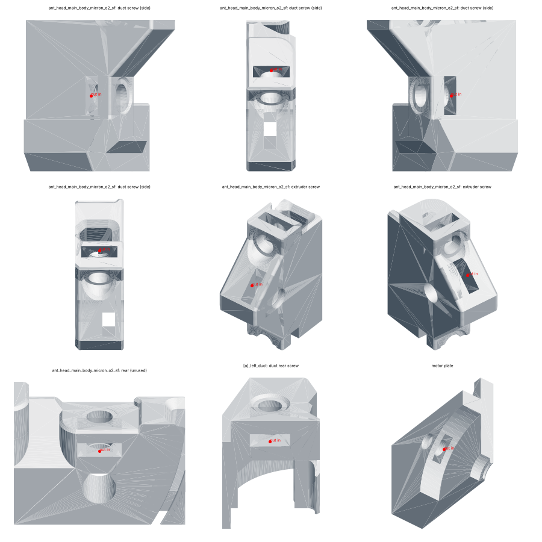
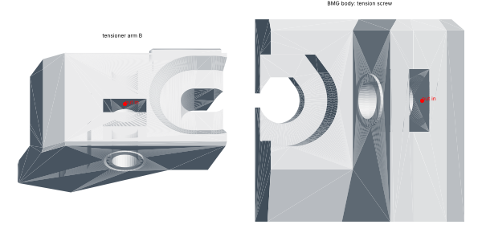

# AntHead – No Heat-Set Inserts (captive square nuts)

Converted versions of the AntHead parts for a **Micron / Salad Fork with a stock Mini SB carriage, BMG extruder and TZ-V6 (2.0) hotend**. Every M3 heat-set insert is replaced with either:

* a **captive M3 square-nut slot** (DIN 562, 5.5 × 1.8 mm). Each slot is 5.7 × 2.0 mm and sits about 2 mm behind the face the screw enters from. The old 4.7 mm insert bore is filled back in to a 3.4 mm clearance hole, so the nut bears on solid plastic. Or
* a **2.7 mm pilot hole** for an M3 screw to thread straight into the plastic. This is used only where the wall is too thin for a nut: the hotend-mount side plates (3.2–4.5 mm thick, with the heatsink bore right behind) and the toolhead-board bosses.

> The slots are sized for **square nuts**. A standard M3 hex nut (2.4 mm thick) will **not** fit in the 2.0 mm slots.

Only the insert locations were changed; every other surface is identical to the stock STLs. Filenames, colour prefixes and `_xN` quantities match the stock files, so swap them in one-for-one.

**Status:** generated from the stock STLs and checked by cross-sections (every part is a single watertight solid, and no 4.7 mm insert bores remain). **Not test-printed yet.** Print the main body first and test-fit a nut before printing everything else.



*Red dot = where the square nut is pushed in.*

## What to print (BMG + TZ-V6 + Micron/Salad Fork)

| Part | File in this folder | Inserts replaced with |
| --- | --- | --- |
| Main body (pick **one** logo, **O2** bolt pattern = BMG/G2) | `STLs/Main_Bodies/O2/<logo>/ant_head_main_body_<logo>_o2_sf_x1.stl` | 7 square-nut slots |
| Left + right duct (standard or HB92) | `STLs/Ducts/SF/` | 1 square-nut slot each |
| Hotend mount, TZ-V6 **with a V6 nozzle** | `STLs/Hotends/[a]_tzv6_v6nozzle_x1.stl` (M3 fan screws) or `..._m2.5_x1.stl` (M2.5 fan screws) | pilot holes |
| Hotend mount, TZ-V6 **with its stock (short, Bambu-style) nozzle** | `STLs/Hotends/[a]_dragon_x1.stl` or `[a]_dragon_m2.5_x1.stl` (the stock README says to use the Dragon mount for this) | pilot holes |
| BMG extruder body | `STLs/Extruders/BMG/extruder_main_body_x1.stl` | 1 square-nut slot (tension screw) |
| BMG motor plate | `STLs/Extruders/BMG/[a]_motor_plate_x1.stl` | 1 square-nut slot |
| BMG tensioner arm B | `STLs/Extruders/BMG/tensioner_arm_b_x1.stl` | 1 square-nut slot |
| Toolhead board mount (Micron) | `STLs/Extruders/BMG/BoardMounts/toolhead_board_mount_anthead_bmg_micron.stl` | 2 pilot holes |

These parts never had inserts, so print them from the stock `STLs/` folder: BMG `[a]_tensioner_arm_a_x1`, the grill, and the LED carrier / diffuser / light shield.

**Carriage:** reuse your existing Mini SB carriage. It already has its inserts fitted and is the carriage the AntHead README specifies for Micron/Salad Fork. It lives in the Micron repo and is **not** converted here.

## Hardware changes

| Joint | Stock | This mod |
| --- | --- | --- |
| Ducts → main body sides (4×) | M3x8 BHCS into inserts | M3x8 BHCS + **square nut** |
| BMG extruder → main body top (2×) | M3x8 BHCS into inserts | **M3x10 BHCS** + square nut. The left nut sits 2.7 mm below the top face, so M3x8 only just catches it. |
| Carriage → duct rear (2×) | stock screw into insert | same screw + square nut |
| Main body rear-centre insert | (no screw in the stock build) | square-nut slot, optional |
| Main body → hotend mount (2×) | M3x6 BHCS into inserts | M3x6 BHCS threaded into the 2.7 mm pilot. Don't over-tighten. |
| Hotend fan (M3 mount) | M3x12 BHCS into inserts | **M3x14 BHCS** threaded into the pilot. The pilot is 3.8 mm deep, and M3x12 would only catch ~2 mm after the 10 mm fan. |
| Hotend fan (M2.5 mount) | M2.5x16 self-tapping | unchanged |
| Toolhead board → board mount (2×) | M3 into inserts | M3 threaded into the 2.7 mm pilots (works from either side) |
| BMG body → motor plate | M3x25 SHCS into insert | M3x25 SHCS + square nut (nut is 1.2 mm behind the face the screw arrives at) |
| Tensioner arm A → arm B | M3x16 SHCS into insert | M3x16 SHCS + square nut (nut is right where the screw comes out of the clearance hole) |
| BMG tension thumb screw | threads into insert | threads into a captive square nut |

**Square nuts needed:** 11 (+1 for the optional rear-centre slot on the main body).
The M2x10 self-tapping screws aren't needed for this build. In the stock build they hold the G2 Wristwatch filament-sensor switches; the Mini SB carriage's X-endstop also uses one M2 self-tapper.

Fit the nuts **before** assembly. Push each one to the end of its slot (it then lines up with the hole), and run the screw in to pull it tight. A drop of CA or a strip of tape over the slot opening keeps a loose nut in place while you assemble.

## Regenerating / converting other variants

`tools/generate.py` rebuilds every STL here from the stock STLs (it finds the 4.7 mm insert bores, chooses a slot direction that exits cleanly into open air with walls of at least ~0.8 mm, and does the booleans with manifold3d):

```bash
pip install numpy trimesh manifold3d shapely scipy rtree matplotlib
python3 UserMods/No_Heatset_Inserts/tools/generate.py --check
```

`--check` also writes before/after cross-section images to `checks/`. The HF/UHF main bodies and ducts can be converted the same way by adding them to `generate.py`.

Based on AntHead (repo state of 2026-05-29, CAD v105). Licensed like the parent project (GPL-3.0).
